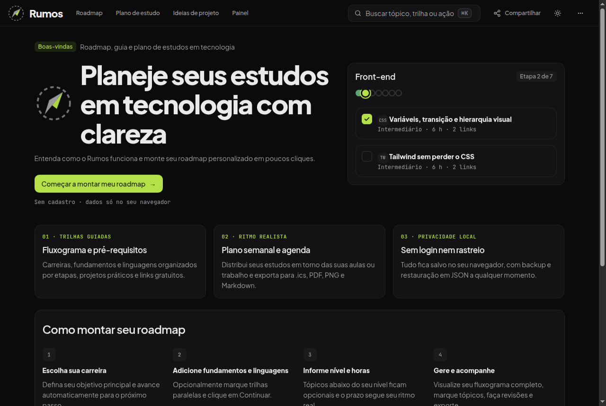
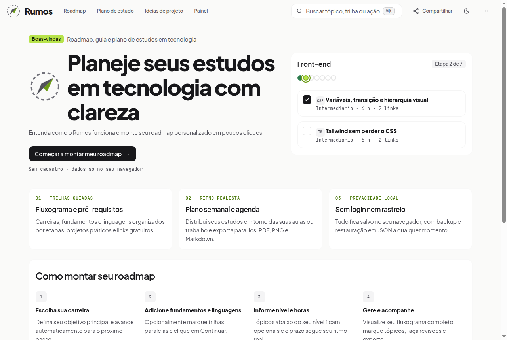
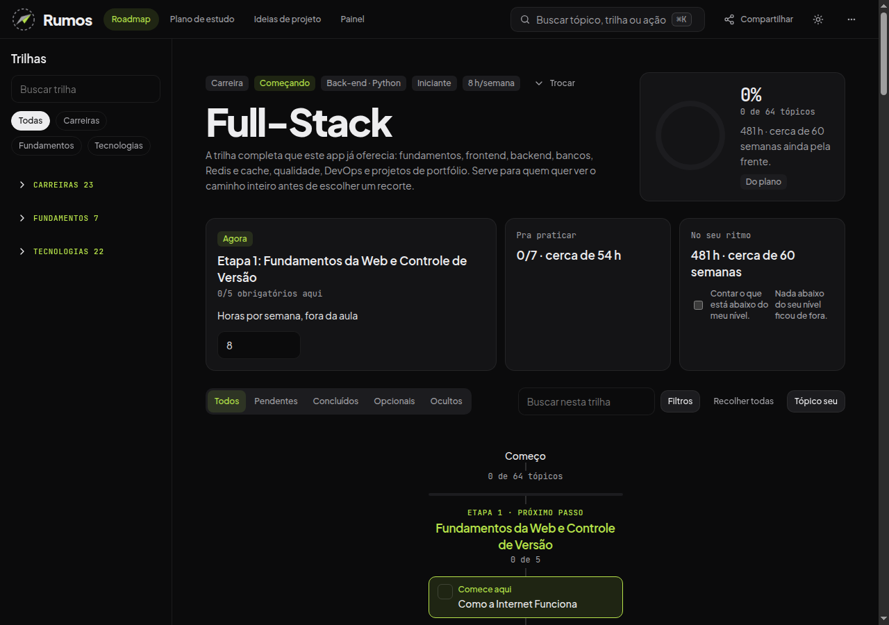
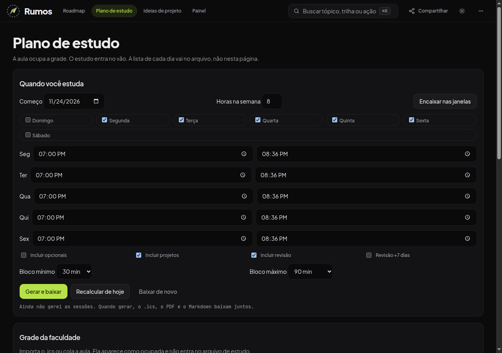
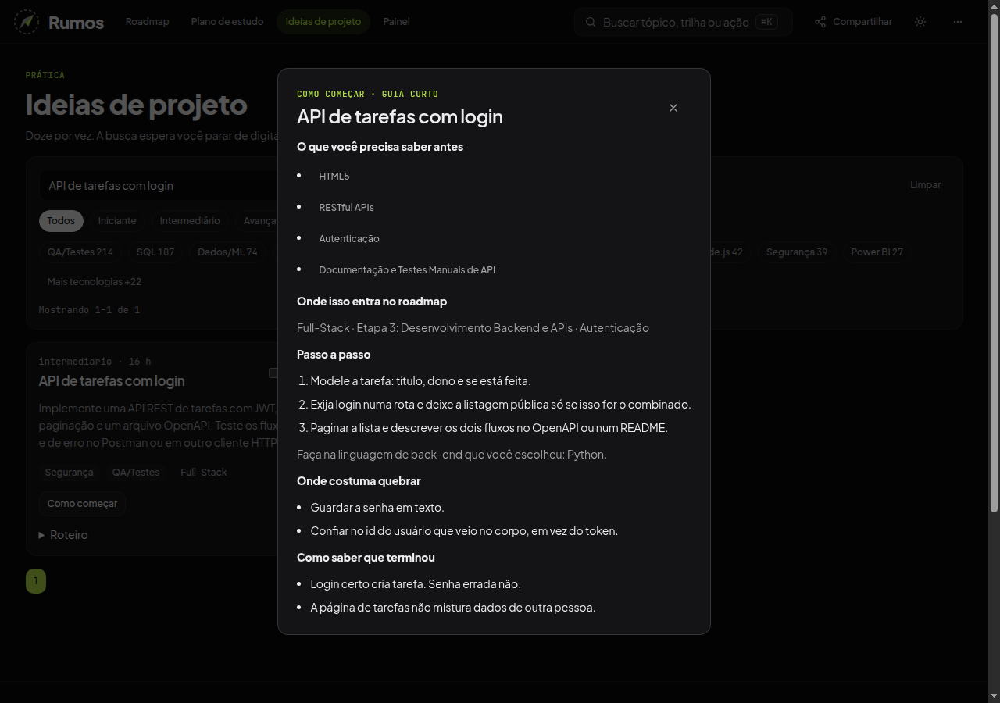
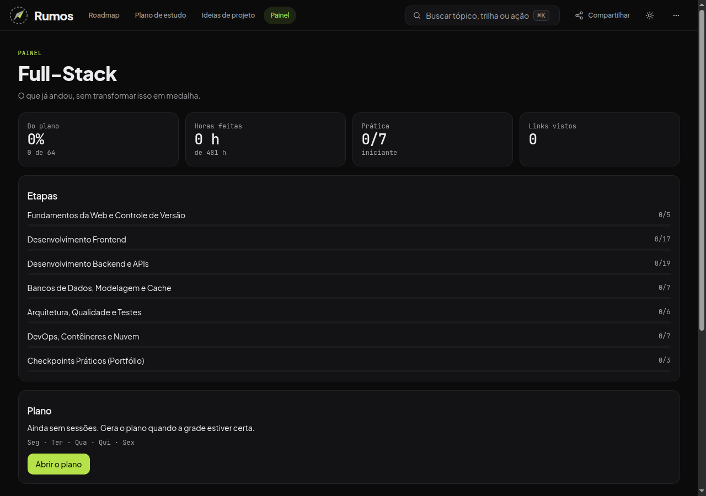

# Rumos

Projeto livre para ajudar estudantes de tecnologia a planejar os estudos. A pessoa escolhe a carreira, o nível e as horas por semana. O Rumos monta a trilha, guarda o progresso neste navegador e encaixa o estudo na rotina.

Não é curso e não dá certificado. Não tem cadastro nem servidor. Foi feito com a ajuda de inteligência artificial, sob a direção de Eduardo Nobilioni.

Publicação: https://eduardonobilioni.github.io/rumos-guia-de-estudos/

Repositório: https://github.com/EduardoNobilioni/rumos-guia-de-estudos

## Telas













## O que dá pra fazer

- Escolher carreira, fundamentos e linguagens, nível e horas. O trajeto combinado junta as trilhas, tira tópico repetido e respeita pré-requisito.
- No Full-Stack, escolher uma linguagem de back-end. Nada vem marcado. Ela troca só a parte de linguagem do servidor. Sem escolha salva, a versão em Node continua até a pessoa escolher.
- Em Front-end e Full-Stack, escolher um framework de interface (React, Vue ou Angular). HTML, CSS e JavaScript ficam.
- Em Jogos, escolher C# ou C e C++. Mobile, Dados e nuvem não pedem caminho: ainda não há trilha para o outro lado.
- Marcar tópico, anotar, ocultar, reordenar, criar tópico e link seu.
- Ideias de projeto com busca, doze por página, e um guia "Como começar" em cada ideia.
- Autoavaliação por etapa. Abaixo de 70% aparece revisão. Não é nota.
- Plano de estudo em volta da grade (`.ics`, CSV ou horário manual). Gerar baixa `.ics`, PDF e Markdown.
- Backup JSON, PNG e PDF da trilha, e link de compartilhar sem anotação nem progresso.
- Tema Limão Escuro (padrão) e Limão Claro. Funciona offline pelo service worker.

As regras de negócio estão em [docs/regras-de-negocio.md](docs/regras-de-negocio.md).

## Como rodar

Os dados são arquivos separados. Precisa de um servidor estático.

```bash
python3 -m http.server 8080
```

Abre http://localhost:8080

## Testes

Não há dependência pra instalar. O `npm` só chama o Node.

```bash
npm test
npm run validate
npm run check-links
```

`npm test` cobre progresso, backup, link, grade, plano e as regras da trilha. `npm run validate` confere as trilhas no Node. O workflow `.github/workflows/ci.yml` roda os dois em pull request.

## Mapa dos módulos

Não tem bundler. O navegador carrega ES modules.

- `js/app.js` sobe a página, troca de tela e liga os botões.
- `js/store.js` guarda estado, sessão e o `localStorage` (`rumo_guia_ptbr_v1`).
- `js/load-tracks.js` lê `data/tracks/index.json` e busca a trilha quando precisa.
- `js/model.js` reexporta `model/storage.js`, `model/validate.js` e `model/roadmap.js`.
- `js/ui/` desenha a casa, a trilha, a barra lateral, os diálogos, o quiz e o ⌘K.
- `js/screens/` é o plano, o painel e as ideias de projeto.
- `js/plan.js`, `js/ics.js`, `js/files.js`, `js/share.js`, `js/projects.js` e `js/project-guides.js` ficam sem DOM.

## Visual

Limão Escuro em `:root`, Limão Claro em `[data-theme="light"]`. Tokens em `css/tokens.css`. Fonte Plus Jakarta Sans e JetBrains Mono, em `woff2`. Sem Tailwind. O movimento usa `transform` e `opacity`, e para com `prefers-reduced-motion`.

A marca é a agulha de bússola desenhada por `brandMark` em `js/ui/dom.js`.

## Licença

MIT. Veja [LICENSE](LICENSE).
