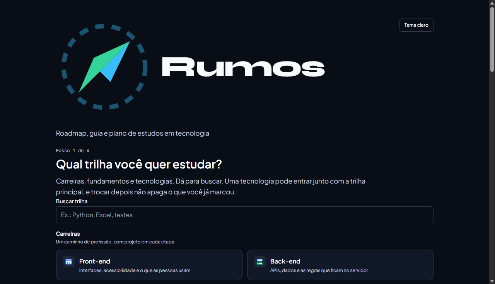
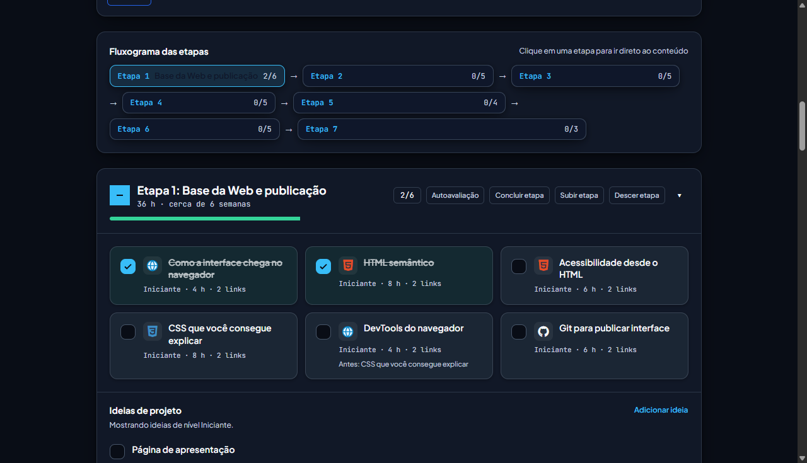
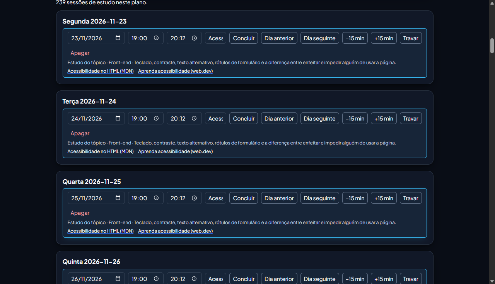

#  Rumo

Rumo: roadmap, guia e plano de estudos em tecnologia. A marca é uma agulha geométrica, desenhada para este projeto: a ponta terracota aponta para nordeste e a cauda é bege. No fundo claro a cauda escurece para `#887655`, porque o bege `#ddc08a` não chega a 3:1 sobre `#e3ded2`. No fundo escuro a ponta clareia para `#9b655d`, porque o terracota `#7a3329` não chega a 3:1 sobre `#2a201a`.

Guia para quem está na faculdade de tecnologia e não sabe por onde começar. Você escolhe a área, o nível e quantas horas consegue estudar por semana. O app monta uma trilha, guarda o seu progresso neste navegador e ajuda a encaixar o estudo na grade da universidade.

Não é um curso e não emite certificado. Não há cadastro, servidor nem login.

A trilha Full-Stack original continua aqui (os 46 tópicos de antes, mais cache HTTP). Em volta dela há carreiras, fundamentos e tecnologias.

Publicação: https://eduardonobilioni.github.io/rumo-guia-de-estudos/

Repositório: https://github.com/EduardoNobilioni/rumo-guia-de-estudos



## O que o app faz

- **Onboarding.** Na primeira visita: trilha, nível (iniciante, intermediário ou avançado) e horas por semana. A escolha é em três grupos — Carreiras, Fundamentos e Tecnologias — com busca. O botão **Refazer/Trocar trilha** abre as mesmas perguntas. O progresso de cada trilha fica guardado.
- **Tecnologia junto.** Na escolha da trilha dá para marcar uma ou mais trilhas de tecnologia (Python, JavaScript, TypeScript, React, Node.js, SQL, Git e GitHub, Linux, Docker, Kubernetes) para estudar ao lado da principal. O progresso não se mistura. No topo da página, os botões trocam de trilha.
- **Personalização e links.** Tópicos abaixo do seu nível começam como opcionais. Você pode torná-los obrigatórios, ocultá-los, criar os seus (com múltiplos recursos) e reordenar tópicos e etapas. Em qualquer tópico dá para adicionar links próprios (**+ Link**), marcar materiais como vistos e filtrar por idioma (`PT` / `EN`) ou formato. Trocar de trilha não apaga as outras.
- **Anotações.** Cada tópico tem anotações. Cada etapa tem um campo **Observações**.
- **Projetos.** Cada etapa traz ideias por nível. Dá para ver só o seu nível ou todos. Muitos projetos têm roteiro e definição de pronto, com caixas para ir marcando. Você também pode criar uma ideia sua e marcar projetos como feitos.
- **Autoavaliação.** Perguntas de múltipla escolha por etapa e, em alguns tópicos, no próprio tópico. A resposta aparece na hora, com uma explicação. Se errar, o app aponta o tópico para revisar. Se o acerto ficar abaixo de 70%, a etapa ou o tópico mostra **Revisar**. Não é nota.
- **Plano de estudo.** Você escolhe a data de início, os dias, o horário de cada dia e o tamanho mínimo/máximo dos blocos de estudo. As horas da trilha já vêm preenchidas. O app distribui tópicos, projetos e revisões (inclusive revisão espaçada +7 dias e tecnologias paralelas intercaladas, se marcado), na ordem e respeitando pré-requisitos. As sessões mostram os links do tópico e permitem concluir direto pelo plano. A prévia deixa mudar data, horário e nome (travando a sessão editada e alertando sobre conflitos com aulas ou outras sessões), apagar, encurtar ou alongar 15 minutos e pular datas. **Recalcular a partir de hoje** remonta o que ainda não passou e preserva o que está travado.
- **Grade da faculdade.** Dá para importar um `.ics` (Google Agenda, Outlook, Apple Calendar ou o sistema da universidade), cadastrar o horário semanal na mão ou colar um CSV (`seg,08:00,10:00,Cálculo` ou uma data). Aulas aparecem como **Ocupado** e o estudo não cai em cima delas. Você pode reservar minutos antes e depois da aula e reduzir a carga numa semana de prova.
- **Exportar e compartilhar.** Backup JSON (o arquivo antigo do Full-Stack ainda importa), checklist Markdown, imagem PNG, PDF da trilha, PDF e impressão do plano, e um `.ics` só com as sessões de estudo. O link de compartilhar leva a configuração da trilha, não as anotações nem o progresso.
- **Visualização em mapa + popup.** Por padrão, cada etapa exibe um mapa limpo com nós clicáveis (nível, horas, quantidade de links e pré-requisitos). Clicar no tópico abre o popup com descrição, recursos filtráveis, anotações, quiz e ações — ou você pode alternar para **Modo: Lista detalhada** quando quiser.
- **Temas e offline (PWA).** Claro e escuro (seguindo o sistema quando não há preferência salva) e suporte offline via Service Worker (`sw.js`) e `manifest.webmanifest`.





## Trilhas

**Carreiras.** Front-end, Back-end, Full-Stack, Ciência de Dados, Analista de Dados, Engenharia de Dados, Machine Learning e IA, Java e Spring Boot, Mobile, QA e Testes de Software, DevOps, Cibersegurança, Cloud e Arquitetura em Nuvem, Arquitetura de Software e System Design.

**Fundamentos.** Fundamentos da Computação, Estruturas de Dados e Algoritmos, Banco de Dados e Modelagem, Engenharia de Software e Boas Práticas.

**Tecnologias.** Python, JavaScript, TypeScript, React, Node.js, SQL, Git e GitHub, Linux, Docker, Kubernetes.

Ciência de Dados é a trilha que se chamava Dados. O identificador no arquivo e no progresso salvo continua `dados`, então tópico marcado, anotação e autoavaliação antiga permanecem. Os tópicos novos (planilha, Power BI, teste A/B, coleta) entram sem apagar os antigos. Analista, Engenharia de Dados e Machine Learning são trilhas novas, com o próprio progresso. Quem abre a Ciência de Dados vê um aviso disso, uma vez.

## Como usar

1. Abra o site. Se for a primeira vez, busque ou escolha a trilha, o nível e as horas. Se quiser, marque uma tecnologia para estudar junto. Leia o resumo e toque em **Começar trilha**.
2. Marque um tópico quando terminar. O visto no quadrado confirma, além da cor. A barra mostra só os tópicos obrigatórios do seu plano.
3. Abra **Anotar** para links e lembretes. Em cada etapa, **Observações** guarda um texto da etapa inteira.
4. Em **Ideias de projeto**, siga o roteiro e a definição de pronto, ou adicione uma ideia sua.
5. Faça a **Autoavaliação** antes de avançar. Se aparecer **Revisar**, volte ao tópico indicado.
6. Abra **Plano de estudo**. Confira dias e horários. Se quiser, importe a grade. Toque em **Gerar plano**.
7. Ajuste as sessões. Use **Dia anterior**, **Dia seguinte**, **−15 min** e **+15 min** se não quiser editar os campos. **Travar** impede que um recálculo mova aquela sessão.
8. Baixe o `.ics` e abra no Google Agenda, Outlook ou Calendário da Apple. Esse arquivo não inclui as aulas.
9. **Exportar JSON** guarda uma cópia. **Importar JSON** restaura, inclusive um backup antigo só com `completed` e `notes`.

## Visual

O visual prioriza leitura confortável, clareza e foco de estudo com base em psicologia das cores e contraste WCAG 2.2 AA: cantos suaves (`6–12 px`), bordas sutis e respiro generoso. O texto corrido e títulos usam Plus Jakarta Sans; horas, metadados e tags usam JetBrains Mono.

| Papel | Claro | Escuro | Uso |
| --- | --- | --- | --- |
| Fundo | `#F7F8FA` | `#0E141B` | Fundo da página |
| Superfície | `#FFFFFF` | `#161F29` | Cartões e popups |
| Texto principal | `#0F172A` | `#F1F5F9` | Leitura principal |
| Texto secundário | `#475569` | `#94A3B8` | Rótulos e metadados |
| Destaque / Foco | `#1D4ED8` | `#60A5FA` | Botões, foco e ação principal |
| Progresso | `#047857` | `#34D399` | Tópico concluído |
| Atenção leve | `#B45309` | `#FBBF24` | Opcional / Revisar |
| Borda / Neutro | `#64748B` | `#64748B` | Contornos e hachura de ocupado |

O horário de aula é hachurado e traz a palavra **Ocupado**. A sessão de estudo tem borda na cor de destaque. Tópico concluído tem um visto desenhado, não só um quadrado pintado. Etapa pela metade mostra um traço.

## Acessibilidade

A meta prática é WCAG 2.2 nível AA. O contraste de texto e de interface também foi medido com APCA, o método de contraste do rascunho WCAG 3.

- O idioma da página é `pt-BR`.
- Dá para percorrer onboarding, trilha, autoavaliação e plano só com teclado. A busca da trilha é um campo com rótulo; Enter leva à primeira trilha visível. Os grupos são grupos de opção, e a tecnologia junto é caixa de seleção. No plano, **Dia anterior**, **Dia seguinte**, **−15 min** e **+15 min** mudam a sessão sem arrastar.
- O foco tem contorno de 2 px, com contraste de pelo menos 3:1 com o fundo ao lado.
- Botões e campos têm pelo menos 24 px de altura.
- Há um link **Ir para o conteúdo**, títulos em ordem e a prévia do plano também em lista de texto.
- Campos têm rótulo. Avisos de erro, exportação e o resultado da autoavaliação saem numa região `aria-live`.
- **Revisar**, **Ocupado** e o visto não dependem só da cor.
- `prefers-reduced-motion` desliga animação. Sem tema salvo, o app segue `prefers-color-scheme`.
- O layout quebra em uma coluna por volta de 320 px e usa `rem` e `ch`, para o texto a 200% refluir em vez de ficar preso.

Como foi testado: `axe-core` 4.14 no Chrome, no onboarding (também a 390 px), na trilha e no plano. Os relatórios estão em `docs/auditoria/`. Nesta rodada o axe não apontou violação. O Lighthouse da rodada anterior marcou 100 nas duas visões e não foi reexecutado agora. Isso não substitui um teste com leitor de tela feito por uma pessoa.

## Dados e privacidade

Tudo fica no seu navegador, na chave `localStorage` `rumo_guia_ptbr_v1`. Quem já tinha dados em `trilha_estudos_ptbr_v2` ou no formato antigo `roadmap_fullstack_ptbr_v1` é migrado na primeira abertura. O progresso não é apagado.

O backup JSON inclui progresso, anotações, observações, projetos criados por você, respostas da autoavaliação, o plano de estudo com a grade importada e as tecnologias marcadas para estudar junto. O link de compartilhar não leva isso: só a trilha aberta, nível, horas, ordem e o que você marcou como opcional ou oculto.

Não há analytics, conta nem envio dos seus dados para um servidor deste projeto. O `.ics` que você baixa é um arquivo no seu computador.

## Estrutura

- `index.html` — página
- `manifest.webmanifest` e `sw.js` — manifesto PWA e cache offline
- `css/app.css` — tema, foco, nós do mapa, hachura da grade e impressão
- `js/app.js` — interface da trilha e da autoavaliação
- `js/plan-screen.js` — plano de estudo e importação da grade
- `js/plan.js` — distribuição das sessões
- `js/ics.js` — leitura de `.ics` e CSV
- `js/model.js` — progresso, importação e validação
- `js/share.js` — link com a configuração
- `js/files.js` — Markdown, PNG e PDF
- `data/tracks/` — conteúdo das trilhas
- `examples/backup-legado.json` — exemplo do JSON antigo
- `docs/screenshots/` — imagens deste README
- `docs/auditoria/` — resultado do axe e do Lighthouse

## Contribuir

O formato de uma trilha nova, dos projetos, do roteiro e das perguntas está em [CONTRIBUTING.md](CONTRIBUTING.md).

## Rodar localmente

Os dados são arquivos separados. Use um servidor estático. Abrir o `index.html` direto bloqueia essa leitura.

```bash
python3 -m http.server 8080
```

Depois acesse http://localhost:8080

## Testes

Não há dependência para instalar. O `npm` só chama o Node.

```bash
npm test
npm run validate
npm run check-links
```

`npm test` cobre progresso, backup antigo, link, recorrência do `.ics`, plano em volta da grade, detecção de conflitos e intercalação de tecnologias. `npm run validate` confere se cada trilha tem etapas, recursos e autoavaliação. `npm run check-links` verifica a disponibilidade HTTP das URLs das trilhas.

## Publicar no GitHub Pages

O site é estático. Não há build.

1. No repositório, abra **Settings → Pages**.
2. Em **Build and deployment**, escolha **GitHub Actions**.
3. O workflow `.github/workflows/deploy-pages.yml` publica o conteúdo da raiz a cada push na `main`.
4. O arquivo `.nojekyll` na raiz impede o Jekyll de ignorar pastas.

O site fica em https://eduardonobilioni.github.io/rumo-guia-de-estudos/

O repositório fica em https://github.com/EduardoNobilioni/rumo-guia-de-estudos

Quando o repositório for renomeado para `rumo-guia-de-estudos`, o Pages passa a usar esse endereço. O caminho antigo deixa de publicar.

## Como este projeto foi feito

A versão original, a trilha Full-Stack, foi criada por Eduardo Nobilioni.

Esta versão — trilhas personalizadas, plano de estudo, importação da grade, autoavaliações, exportações, redesign e acessibilidade — foi desenvolvida com a ajuda de ferramentas de IA: um assistente (Grok Bot) e um agente de código do Cursor. O trabalho foi feito sob a direção de Eduardo, que definiu as ideias, os requisitos e as escolhas de visual, e revisa as mudanças.

O texto das trilhas e os links de estudo também passaram por essa ajuda e podem ter erro. Correção é bem-vinda por issue ou pull request.
